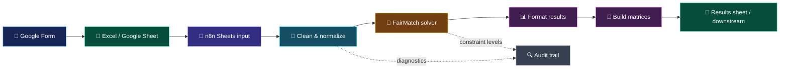

<div align="center">

# ⚖️ FairMatch

### Constraint-aware team formation, built natively for n8n.

Turn messy survey responses into balanced, explainable teams — with hard veto
avoidance, skill coverage, fairness scoring, and an audit trail built in.

[](https://n8n.io/)
[](https://developer.mozilla.org/en-US/docs/Web/JavaScript)
[](LICENSE)

</div>

---

## ✨ What it does

FairMatch is an n8n workflow for building teams from Google Form responses.
The form collects self-assessments and peer scores, sends the responses into
an Excel/Google Sheet, and n8n reads that sheet to produce balanced teams.
Its central job is turning inconsistent human scoring into comparable data:
different questions may use different scales, including mixed 1–5 and 1–10
ratings.

It is designed for real-world input: duplicate submissions, malformed JSON,
missing respondents, and incomplete peer ratings are treated as normal
operating conditions.

The result is more than a roster. Every run produces team assignments,
metrics, diagnostics, and fairness/audit data that can be reviewed before the
results are written back to a spreadsheet.

## 🧭 The pipeline



## 🎯 What the solver optimizes

The solver evaluates candidates lexicographically, so the most important
constraints are considered first:

| Priority | Constraint | Purpose |
| ---: | --- | --- |
| `L1` | Skill floor | Prevent materially weak teams |
| `L2V` | Hard vetoes | Keep incompatible pairs apart |
| `L2` | Willingness floor | Reduce low-confidence pairings |
| `L2C` | Compatibility | Limit soft low-willingness pairs |
| `L5` | Skill balance | Minimize the gap between team averages |
| `L3` | Dimension coverage | Spread technical strengths across teams |
| `L6` | Internal spread | Avoid uneven skill distributions |
| `L4` | Specialist coverage | Preserve tier/role diversity |

The engine combines multi-start drafting with local-search refinement and uses
a fixed seed for repeatable results under the same input and configuration.

## 🛡️ Built for imperfect data

- **Deduplicates submissions** and keeps the latest response per person.
- **Parses resiliently** across structured objects and escaped JSON payloads.
- **Normalizes form scoring scales** when questions or submissions mix 1–5 and
  1–10 responses, so scores can be compared fairly.
- **Imputes missing respondents** from peer consensus when an explicit roster is configured.
- **Detects self/peer disagreement** and records the decision in diagnostics.
- **Builds mutual willingness** from the lower of the two directed ratings.
- **Rejects roster collisions** instead of silently merging people.
- **Emits audit metrics** including veto counts, skill gaps, confidence flags, and grades.

## 🚀 Quick start

### 1. Collect responses in the form

Use a Google Form to collect self-scores, skill scores, and willingness/fit
scores from participants. The form responses land in an Excel or Google Sheet,
which becomes the workflow’s input table.

### 2. Import the sanitized template

Import [`n8n/fairmatch_template.json`](n8n/fairmatch_template.json) into n8n.
It contains no production credentials, participant data, or live spreadsheet
identifiers.

### 3. Connect the response sheet to n8n

Set the response-sheet connection, roster, and output sheets inside your private
n8n instance.
Read [`docs/CONFIGURATION.md`](docs/CONFIGURATION.md) before wiring inputs or
outputs.

### 4. Run and inspect

Run the workflow with representative input, review the audit output, then
enable downstream writes. Keep production data and credentials out of Git;
see [`docs/SECURITY.md`](docs/SECURITY.md).

## 📦 Repository map

```text
.
├── n8n/
│   ├── fairmatch_template.json       # Sanitized importable workflow
│   ├── node1_clean_normalize.js      # Input cleaning + diagnostics
│   ├── node2_solver_engine.js        # Team formation engine
│   ├── node3_format_output.js        # Team + audit row formatting
│   └── node4–node7_*.js              # Optional output matrix helpers
├── docs/
│   ├── CONFIGURATION.md               # Roster and deployment setup
│   └── SECURITY.md                    # Privacy and export guidance
├── LICENSE
└── README.md
```

## 📥 Expected input shape

Each row read from the form response sheet should provide a display name and
gender, plus structured survey fields or a JSON payload:

```json
{
  "display_name": "Participant 01",
  "gender": "F",
  "self": {
    "devops": 4,
    "aiml": 5,
    "general": 4,
    "involvement": 5
  },
  "skill": {},
  "fit": {}
}
```

The normalizer also accepts `email`, `Email`, or `payload` when the form survey
is stored as a JSON string. Numeric values can arrive on different rating
scales; the cleaning stage detects the observed scale and maps values onto a
common 1–5 basis before scoring.

## 📤 Output highlights

Each run can expose:

- team assignments and member-level skill scores;
- team averages, totals, gender counts, and weakest pair;
- veto and low-willingness counts;
- solver status and lexicographic constraint levels;
- deduplication, parsing, disagreement, and low-confidence diagnostics;
- fairness scores and letter grades for review workflows.

## ✅ Verification

The repository has no production runtime dependency installation step.
Syntax-check the standalone Code-node files locally with:

```powershell
Get-ChildItem n8n -Filter *.js | ForEach-Object { node --check $_.FullName }
```

For the pinned workflow export's actual cleaning and solver nodes, run the
synthetic JavaScript/Python parity check (Python 3.11+ and Node.js 24.x):

```powershell
python -m unittest discover -s verification -p 'test_*.py'
python verification/run_parity.py
```

The harness extracts Code nodes from `n8n/fairmatch_template.json`, verifies
their source hashes, and compares three synthetic scenarios with the included
Python v4 reference. It checks latest-submission deduplication, team membership,
solver status, constraint levels, and hard constraints. The generated report is
`verification/PARITY_REPORT.txt`. This is a new synthetic verification; it does
not prove a historical comparison or production recovery.

## 🔐 Public-repository boundary

This repository intentionally excludes production spreadsheet IDs, credentials,
participant data, generated results, screenshots, and local deployment notes.
Treat survey responses and workflow exports as private data.

## 📄 License

MIT — see [`LICENSE`](LICENSE).

<div align="center">

Built for teams that want the outcome to be fair — and the reasoning to be visible.

</div>
